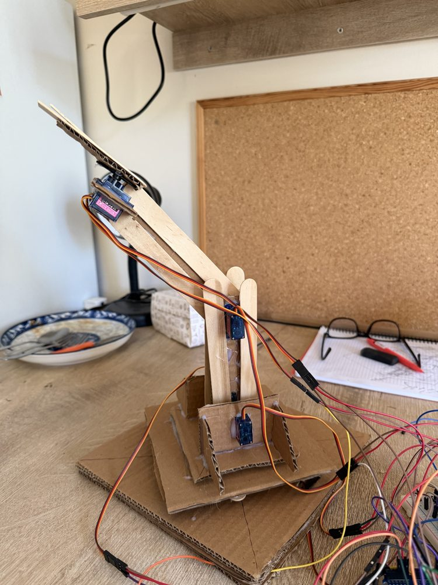
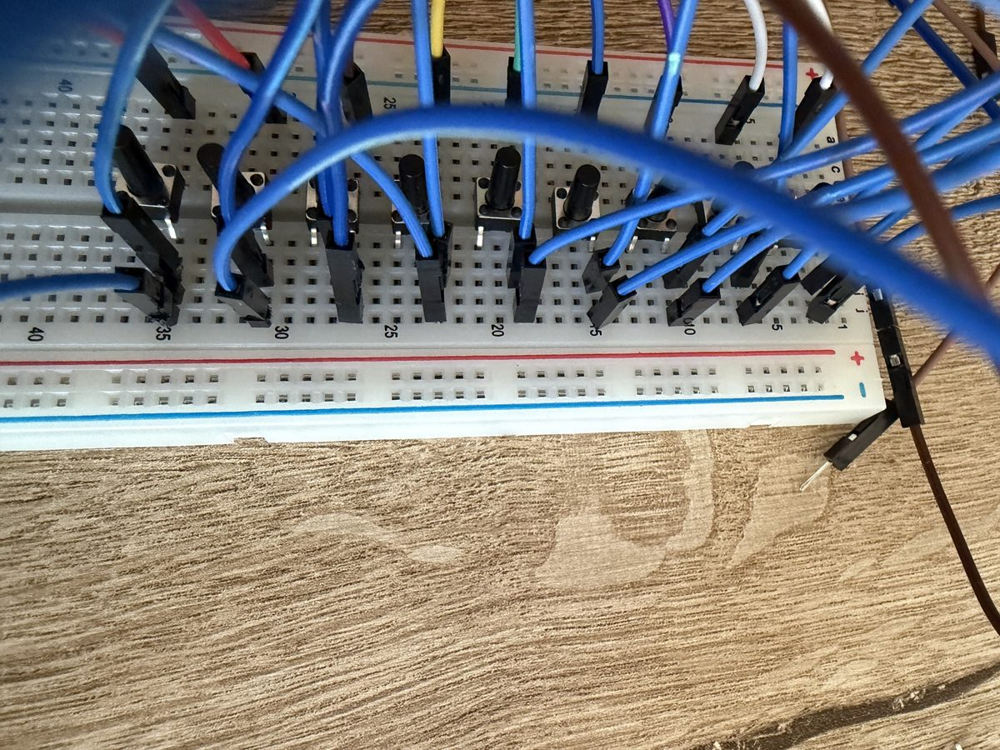
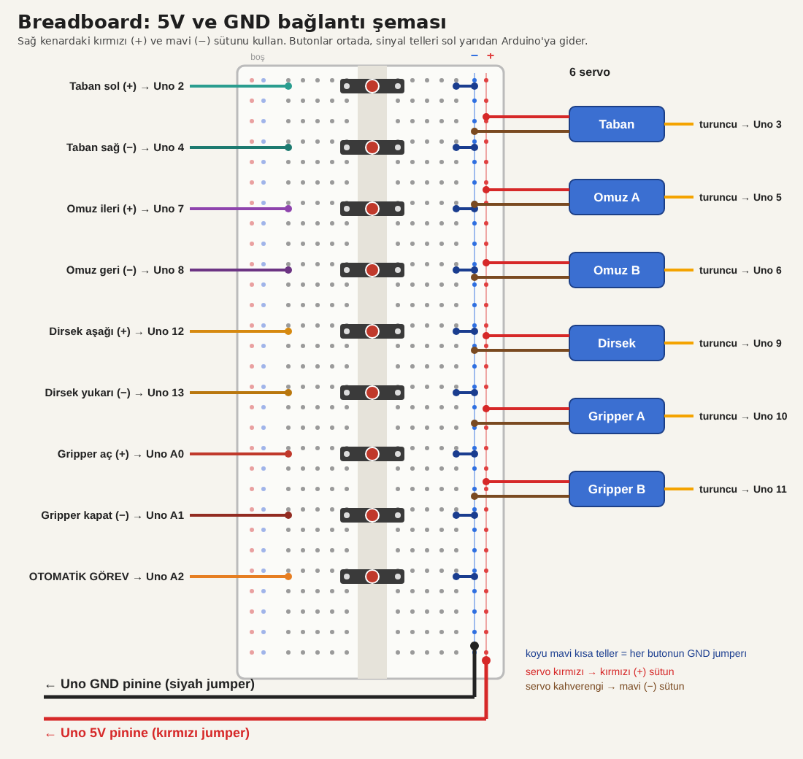
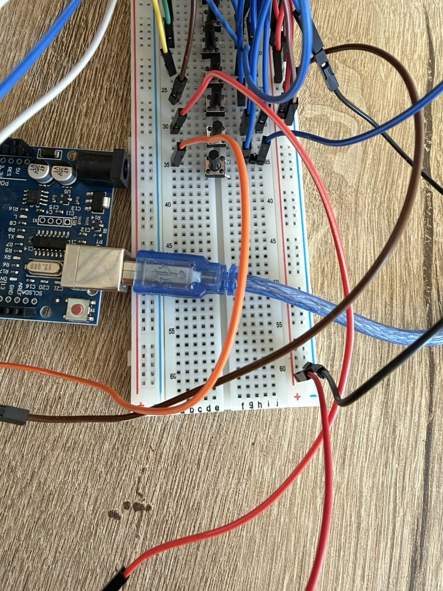

# 4-DOF Karton Robot Kol (Arduino Uno, 6× SG90)

Dönme matrislerinden (Rx/Ry/Rz → atan2) servo açısı hesaplayan, butonlu ve otomatik görevli robot kol.

- **Servolar:** taban (pin 3), omuz 2 adet ters (5, 6), dirsek (9), gripper 2 çene ters (10, 11)
- **Butonlar:** taban 2/4, omuz 7/8, dirsek 12/13, gripper A0/A1, otomatik görev A2 (`INPUT_PULLUP`, diğer bacak GND'ye)
- **Görev:** 3 küpü (kırmızı, yeşil, mavi) alıp kendi hedeflerine (A, B, C) taşır.
- **Seri monitör (9600):** `j <base|shoulder|elbow|grip> <derece>` · `fk` · `home` · `task` · `stop` · `setstart` (mevcut pozu açılış pozu olarak kaydeder) · `resetstart`

## Buton testi ve breadboard bağlantısı

Butonlar önce `test_donanim/buton_testi.ino` ile tek başına denendi. Bir butona basınca adı seri monitöre (9600 baud) yazılır, örneğin `Base right pressed`. Servolar bu aşamada takılı değildi.

### Butonlar

Her butonun iki bağlantısı var:
- bir bacak → Arduino'daki pin (sinyal teli)
- karşı bacak → mavi (−) ray, yani GND

| Buton | Pin | Buton | Pin |
|---|---|---|---|
| Taban sol | 2 | Dirsek aşağı | 12 |
| Taban sağ | 4 | Dirsek yukarı | 13 |
| Omuz ileri | 7 | Gripper aç | A0 |
| Omuz geri | 8 | Gripper kapat | A1 |
| Otomatik görev | A2 | | |

Butonlar breadboard'un ortasındaki oluğu köprüler: iki bacak üst yarıdaki, iki bacak alt yarıdaki deliklere girer.

### Güç rayları

- Arduino **GND** → mavi (−) ray
- Arduino **5V** → kırmızı (+) ray
- Servo kırmızı kablo → kırmızı (+) ray, kahverengi kablo → mavi (−) ray, turuncu kablo → servonun pini

Bir ray sırasındaki bütün delikler birbirine bağlıdır. Kabloyu sıranın herhangi bir boş deliğine takabilirsin.

### Test sırasında karşılaşılan sorun

Butona basmadan seri monitöre sürekli `... pressed` yazılıyordu. Sebep: butonun içinde birbirine hep bağlı olan bacaklar oluğun iki yanına denk gelmişti, yani devre basmadan kapalıydı. **Butonu 90° çevirip tekrar takınca** sorun çözüldü. Bacakların sıkıca oturduğundan da emin olmak gerekiyor, eğri bacaklar temas etmeyebilir.

Doğru bağlantıda: basmadan monitör sessiz kalır, basınca butonun adı yazılır.

## Klasörler
- `src/main.cpp` – Arduino/PlatformIO kodu
- `diagram.json`, `wokwi.toml` – Wokwi devresi (PlatformIO derlemesi sonrası çalışır)
- `simulasyon/robot_kol_simulasyon.html` – tarayıcıda açılan 3D simülasyon (küpler, hedefler, otomatik görev)
- `test_donanim/buton_testi.ino` – butonları seri monitörden test eden küçük kod (kendi klasöründe aç)
- `karton_sablonlar.pdf` – 1:1 karton kesim şablonları
- `gorseller/` – README fotoğrafları
- `arduino-denemeler/` – eski deneme kayıtları

> Konum sabitleri (omuz yüksekliği, tutma noktası, küp/hedef açıları) kendi kolunun ölçüsüne göre kalibre edilmelidir.
